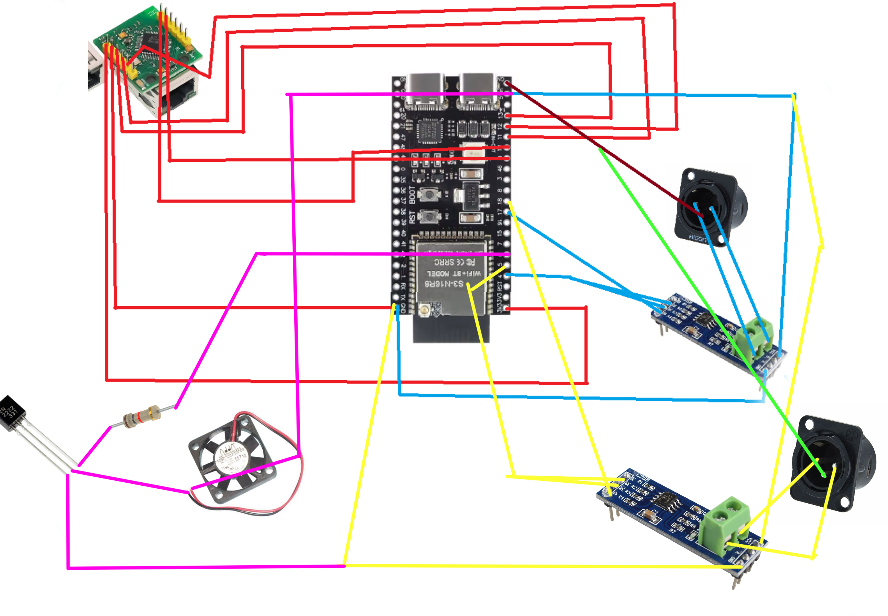
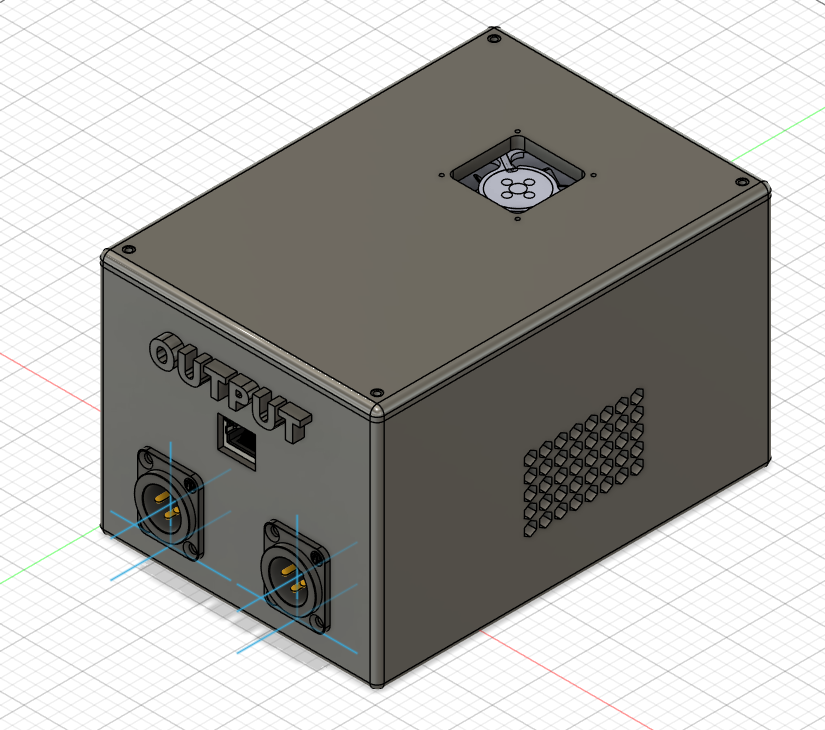
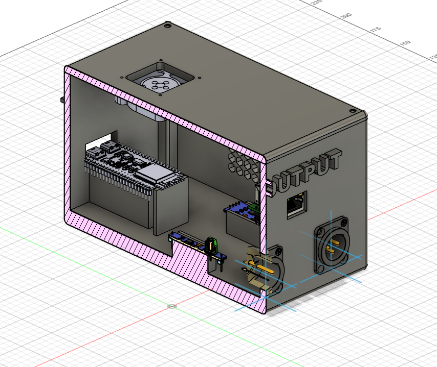

# DMX-Unit-DIY
A DIY project for a DMX controller box that enables stable lighting control via Wi-Fi or USB, featuring both Art-Net and DMX outputs.

The project is designed to manage stage lighting systems with up to 2 DMX universes, Art-Net protocol, WiFi and USB input, and a very good stability.

The goal is to not pay hundred of dollars on a already existing product, and learn ! DMX Unit DIY is also intended to be a hardware platform for a future open-source lighting-control system.

---

## Features

* 2× DMX512 outputs
* 1 ArtNet output
* USB-C connectivity for the input
* Wi-Fi connectivity for the input
* Active cooling
* Web interface for the control
* Custom 3D-printed enclosure
* Compact and portable design
* External access to all main connections
* Designed for DIY assembly and reproduction
* Low-cost hardware

And the design is made to be upgradable/updatable easely if necessery, so it will be able to last over time.

---

## Architecture

The ESP32-S3 is the central processor of the system. It handles network communication, DMX processing, website and other. Lighting data is processed by the MAX485 module and sent to the required DMX outputs, or ArtNet output via the W5500 RJ45 module.

---

## Hardware and BOM

The current design uses the following main components:

| Component | Quantity | Price |
| --- | ---: | ---: |
| [W5500](https://fr.aliexpress.com/item/1005007639330460.html) | 1 | $6.27 |
| [MAX485 RS-485 Module](https://fr.aliexpress.com/item/1005008477779481.html?spm=a2g0o.productlist.main.39.61a4672cybk6KC&algo_pvid=28383e4a-b567-4516-a6ae-09f1f8b8f8d6&algo_exp_id=28383e4a-b567-4516-a6ae-09f1f8b8f8d6-38&pdp_ext_f=%7B%22order%22%3A%2291%22%2C%22eval%22%3A%221%22%2C%22fromPage%22%3A%22search%22%7D&pdp_npi=6%40dis%21EUR%210.86%210.86%21%21%210.98%210.98%21%40210381f017891982833397272e0cf4%2112000045321729373%21sea%21FR%218054027548%21X%211%210%21n_tag%3A-29919%3Bd%3A8484f755%3Bm03_new_user%3A-29895&curPageLogUid=GAJrKxNpKqLO&utparam-url=scene%3Asearch%7Cquery_from%3A%7Cx_object_id%3A1005008477779481%7C_p_origin_prod%3A) | 2 | 2x$1 |
| [ESP32-S3](https://fr.aliexpress.com/item/1005008809316571.html) | 1 | $3.95 |
| [XLR 3-Pin Panel Mount Female](https://fr.aliexpress.com/item/1005008919369057.html) | 2 | $4.88 |
| [Dupont Cables](https://www.aliexpress.com/ssr/300000512/BundleDealsDutyCovered) | 1 kit | $2.48 |
| [Heat-Set Threaded Inserts](https://fr.aliexpress.com/item/1005007640664497.html) | 4 | $1.86 |
| [M2 Metric Screws](https://fr.aliexpress.com/item/32810852732.html) | 4 | $1.54 |
| [40 × 40 mm Fan](https://fr.aliexpress.com/item/1005006212685458.html) | 1 | $3.21 |
| [2N2222 Transistor](https://fr.aliexpress.com/item/1005010473134376.html) | 1 | $1.55 |
| [1 kΩ Resistor](https://fr.aliexpress.com/item/1005007010335100.html) | 1 | $1.59 |
| **Total** | | **$29,33** |

The complete component list is available in [BOM.csv](BOM.csv).

---

## Processing and memory

I selected the ESP32-S3 beacause the project require beacasue it has a bit of processing power for two DMX universes, though not a huge amount. That’s why it’s better suited for the task than, a Raspberry Pi.

It is responsible for:

* Art-Net communication
* DMX universe management
* DMX monitoring
* Failover logic
* Fan and thermal management
* System logs and diagnostics
* Web interface
* USB-C inputs
* WiFi input

All the data, save and other are stored in the internal storage system of the ESP32

---

## DMX

The DMX Unit is designed to support up to 2 DMX universes.

Each output uses a MAX3485 RS-485 transceiver and includes transient protection. A DMX universe contains up to 512 channels, giving a theoretical total of 1024 channels.

Standard DMX wiring is used, controlled by two hardware UART serial ports on the ESP32.

The DMX data rate is 250 kbit/s.

Integrated DMX features include:

* Flexible universe routing (for network universes)
* USB signal-loss detection and automatic failover
* DMX monitoring
* It work

For example, one network universe can be routed to several physical outputs.

---

## ArtNet

The DMX Unit supports Art-Net over Ethernet for up to 2 universes.

Art-Net data is received via UDP on port 6454 through the W5500 SPI Ethernet controller.

Current Art-Net features include:

* ArtDmx packet reception and universe decoding
* Automated ArtPoll discovery response (ArtPollReply)
* Static IP and netmask configuration via Web portal

--- 

## Cooling

The system include a 40x40 fan on the top of the box, manageable in PWM. There is also some grid on the two side of the box.

Air enters from the top and is directed onto the module that generates the most heat the ESP32. It then exits the enclosure through the sides.

---

## Web interface

The DMX Unit features an integrated Web server for system management and configuration.

The Web interface is accessible in Station mode via the local network IP or in Access Point mode with a captive portal at 192.168.4.1.

Current Web interface features include:

* Real-time network and DMX output status monitoring
* Ethernet network configuration (Static IP, Gateway, Subnet Mask)
* Wi-Fi credentials management (SSID and Password)
* Art-Net universe routing and node naming (Short Name and Long Name)
* Cooling fan speed adjustment (PWM duty cycle)
* USB input toggle for DMX output 1
* Remote device reboot functionality

Please note that the unit cannot control lights in standalone mode, it is designed for use with DMX output software, such as QLC+.

---

## Componments and enclosure

There is no PCB in this project, beacause it's not required. Here is all the componments include:

* ESP32-S3 x1
* MAX485 x2
* XLR female port x2
* W5500
* 40x40 fan and its mandatory components (transistor and resistor)

Here's a schema of the connection between all the componemnts:

The case is 12x17x10 and is design to perfectly house all components, be easy to install, not take up much space, and be durable.

Here's a look at it:

Assembly file: [Unite DMX - Assembly.step](3D-files/assembly/Unite%20DMX%20-%20Assembly.step)

---

## Estimate cost

The current estimate is $29,33 of components.
This does not include assembly, enclosure parts or future design changes, and print filament that I already have.

---

## Project journal

The development process is documented in [JOURNAL.md](JOURNAL.md)

It includes in-depth design, configuration, part of the code, enclosure design, BOM creation and the problems encountered during development.

---

## Inspiration and credits

The DMX Unit DIY project was inspired by the ENTTEC Open DMX USB interface.

The DMX Unit DIY is an independent design developed from this inspiration.

Credits:
* ENTTEC Open DMX USB — inspiration for the project concept and overall goal of creating an affordable DMX interface.
* GrabCAD community — some 3D component models were used as reference geometry for the CAD assembly. The original authors retain ownership of their respective models:
* ESP32-S3 — main microcontroller platform.
* W5500 — Ethernet controller used for network connectivity.
* MAX485 — RS-485 transceiver used for the DMX interfaces.

All custom enclosure designs, assembly work, wiring, firmware, and project documentation were created as part of the DMX Unit DIY project unless otherwise stated.